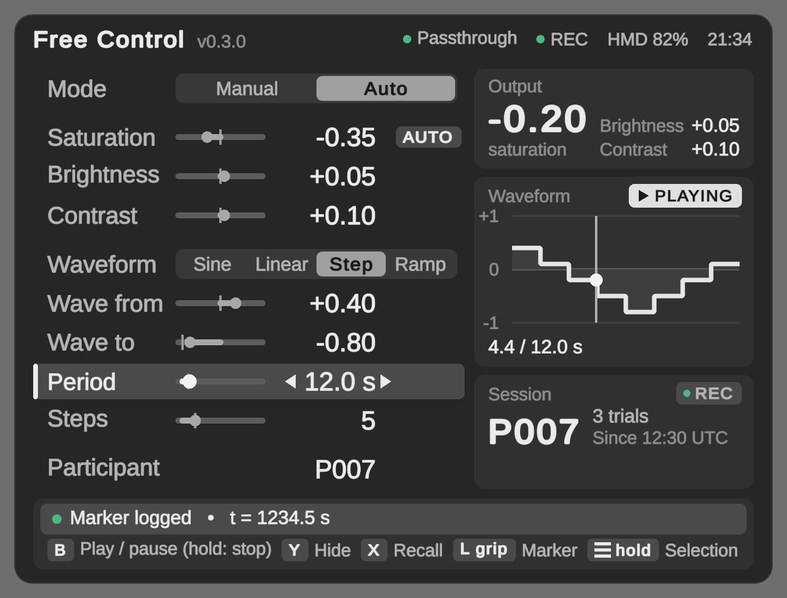
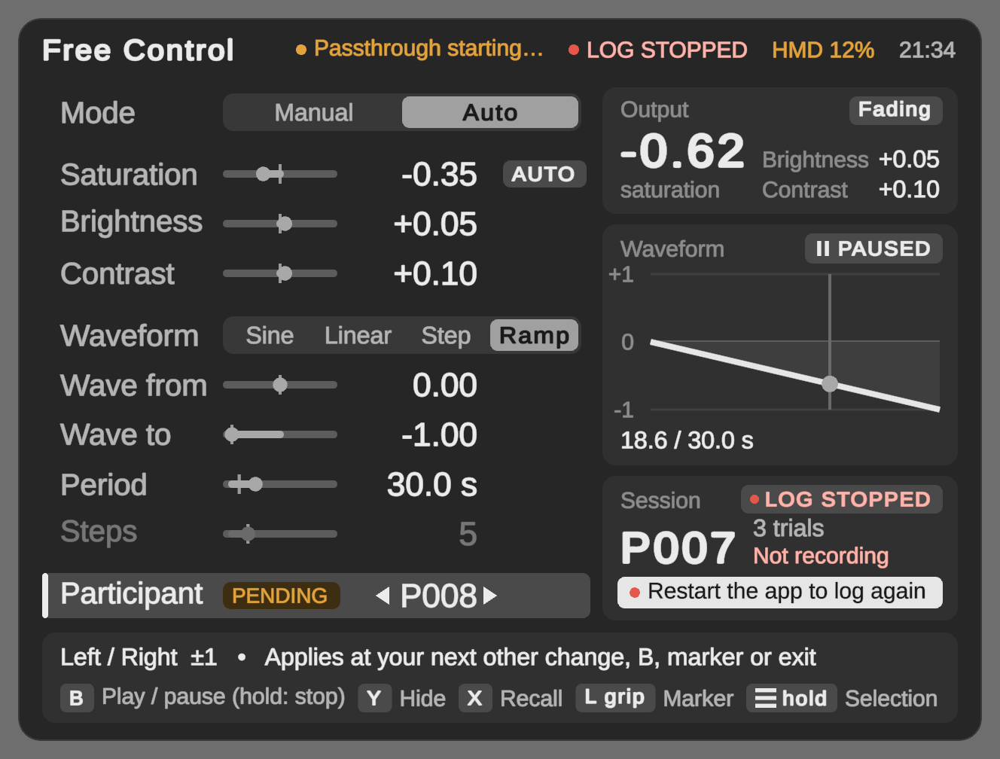

# QuestSaturationExperiment

Full-Field Color Manipulation Library for Meta Quest 3

Author: Ryo Matsuzaki
License: MIT

A Unity project for changing the brightness, contrast and saturation of the entire passthrough view on Meta Quest 3 in real time. It uses `OVRPassthroughLayer.SetBrightnessContrastSaturation`; each value is in [-1, +1], 0 means "unchanged", and saturation -1 is grayscale.

It contains two modes:

- **Experiment**: a 3-condition task (no change / strong desaturation / strong over-saturation). The protocol and timing are the same as in 0.2.0.
- **FreeControl** (operator mode): set brightness, contrast and saturation by hand, or let saturation follow a waveform.

Every session is written to a CSV log on the headset.

[日本語版 README](README_japanese.md)

## Requirements

Unity 6000.3.7f1 / URP 17.3 / Meta XR SDK 207.0.1 / OpenXR 1.16 / Meta Quest 3 (Android build). Controllers are required (hand tracking is off).

## Experiment

1. **Selection**: the view is white and three spheres are shown. Aim with the right controller and press **either index trigger** to choose. The ray always comes from the right hand; the log records which trigger was pressed.
2. **Trial**: passthrough is shown. Saturation stays at 0 for 3 s, ramps linearly to the target over 10 s, then holds the target. Timing starts on the frame the sphere was chosen.
3. Hold the **right A** button for 2 s to end the trial and return to Selection.

| Condition | Target saturation |
|---|---|
| A | 0.0 |
| B | -0.8 |
| C | +0.8 |

The profile is fixed in code (`ExperimentProfile.Canonical`) and cannot be changed from the Inspector, so a build always runs the same protocol. During a trial only the A-hold reset and the marker (left grip) work; other buttons are ignored and logged as `input_ignored`.

## Operator mode (FreeControl)

Hold the **left ☰ (menu)** button for 1.5 s in Selection to enter FreeControl, and again to go back. It cannot be entered during a trial. FreeControl always starts in Manual mode with playback stopped and the cursor at the top (Mode), and fades from the current view over 0.5 s.

| Button | Action |
|---|---|
| Right stick up / down | Select a parameter |
| Right stick left / right | Change the value. Decimal values repeat while held; Steps and Participant change one step per push |
| Right stick click | Reset the selected parameter to its default (not Participant, so a stray click cannot switch the log to P000) |
| Right B (tap) | Play / pause the waveform (switches Manual to Auto) |
| Right B (hold 1 s) | Stop and rewind |
| Left Y | Show / hide the panel |
| Left X | Bring the panel back in front of you |
| Left grip | Add a marker to the log (works in every mode; no vibration during a trial) |
| Left ☰ (hold 1.5 s) | Back to Selection |

| Parameter | Range | Step | Default |
|---|---|---|---|
| Mode | Manual / Auto | | Manual |
| Saturation | -1 to +1 | 0.05 | 0 |
| Brightness | -0.5 to +0.5 | 0.05 | 0 |
| Contrast | -1 to +1 | 0.05 | 0 |
| Waveform | Sine / Linear / Step / Ramp | | Sine |
| Wave from | -1 to +1 | 0.05 | 0 |
| Wave to | -1 to +1 | 0.05 | -1 |
| Period s | 1 to 120 | 0.5 | 10 |
| Steps | 2 to 20 | 1 | 5 |
| Participant | 0 to 999 | 1 | 0 |

- **Auto** drives saturation only; brightness and contrast keep their Manual values. Going back to Manual returns to the Manual saturation.
- Every waveform starts at *Wave from*. Sine, Linear and Step go to *Wave to* and back once per period (Step moves one level at a time). Ramp goes from *Wave from* to *Wave to* once and holds.
- Changing the period while playing does not make the value jump. Pause keeps the position; Stop rewinds.
- The right stick accepts only the direction you first pushed (up/down or left/right) until it returns to center, so passing through a diagonal while changing a value does not move to another row. Return it to center before switching.
- Parameters and the participant ID are saved on the headset and restored on the next launch. Mode and playback state are not saved.
- **Photosensitivity**: Auto mode changes the whole field of view. Check participants for photosensitivity before using it. The period cannot be shorter than 1 s.

### Operator panel



The panel is shown only in FreeControl. It is hidden whenever Selection or a trial starts. It appears about 0.8 m in front of you, a little below eye level, tilted to face you. **Left X** brings it back in front of you and **left Y** hides it. It covers part of the view, so hide it while you judge colors.

- **Parameters (left)**: the right stick moves the highlight. On the selected row the arrows dim at the end of the range. The short tick on each bar marks the default. Steps is grayed out unless the waveform is Step. **AUTO** on Saturation means the waveform is driving saturation instead of this value. **PENDING** on Participant means a new ID that is not in the log yet (see [Session logs](#session-logs-csv)).
- **Output**: the values sent to the passthrough layer right now, including the 0.5 s fade (**Fading**).
- **Waveform**: one period of the shape selected on the left, and whether it is playing. In Auto it shows the playhead and the elapsed time.
- **Session**: the participant being logged, the number of trials and when the current log file started. The strip below shows the next participant ID while it is pending, or what to do if logging has stopped.
- **Header**: passthrough, log, headset battery and the time. Green means OK, amber means wait or check, red means a problem. Passthrough turns green only after the camera image is actually showing.
- **Footer**: what the stick does on the selected row, and the buttons.

Short notices cover the footer hint for a few seconds: a marker was logged (with its `t_realtime_s`, so you can find the row in the CSV), a value was reset (with the old value, in case the click was an accident), a new participant's log started, a Ramp finished, or logging stopped. One notice shows at a time and a new one replaces it; when a marker or a reset is what starts a new participant's log, the notice says both. The Ramp notice does not replace another notice, because the Waveform card already says FINISHED. When logging has stopped or no log file is open, markers and participant changes say that they were not recorded; the marker time shown is the one written to the CSV. While you hold **right B** or **left ☰**, a bar across the top fills up and says what happens if you let go now.



*Several warnings at once: passthrough still starting, logging stopped, low headset battery, a pending participant ID and a fade in progress. When the status items need the room, the version number is hidden.*

The panel is gray; color is used only for status. It uses no images (shapes are generated in code, and text uses the TextMesh Pro font atlas), and its inside is fully opaque, so passthrough never shows through it.

## Session logs (CSV)

Files are written to `Android/data/com.ryomtzk.questsaturationexperiment/files/sessions/session_<UTC time>_P<participant>.csv`. A new file starts at each launch and whenever the participant ID changes. Stepping through IDs does nothing yet: the change takes effect at the next change to another item (not Participant), play / pause / stop, marker, or when you leave FreeControl. Until then the panel marks the Participant row **PENDING** and the Session card shows `Next: P008 • pending`. Going back to the original ID before then changes nothing. A new participant's trials are numbered from 1; going back to an ID already used in this launch continues its numbering. After a relaunch numbering starts from 1 again, so use `session_id` to tell files apart.

- Sample rows: every frame during a trial, 10 per second otherwise. Written to disk every second.
- Event rows: written to disk immediately. If the app crashes, at most about 1 s of samples is lost.

| Column | Meaning |
|---|---|
| `session_id`, `participant_id` | Session (UTC start time + participant) and participant ID |
| `wall_clock_utc` | UTC time, ISO 8601 |
| `t_realtime_s`, `t_game_s`, `frame`, `unscaled_dt` | Time since start, `Time.time`, frame number, frame time |
| `state` | `Selection`, `Trial` or `FreeControl` |
| `trial_index`, `condition` | The participant's trial number (from 1; see above) and condition |
| `trial_stage`, `trial_elapsed_s`, `target_saturation` | `hold` / `ramp` / `target`, the seconds passed to the curve, and the condition's target |
| `passthrough_visible` | 1 when the layer is on and has been rendered since it was turned on |
| `saturation`, `brightness`, `contrast` | Values actually sent to the layer (after clamping) |
| `free_mode`, `waveform`, `playing` | FreeControl state |
| `active_controller` | `OVRInput.GetActiveController()` |
| `event`, `detail` | Event name and `key=value;...` details (empty on sample rows) |

Events: `session_start` (app version, git commit, device, refresh rate, time zone, experiment profile), `state_change`, `condition_selected` (sphere position, material, trigger), `trial_start`, `layer_enabled`, `passthrough_resumed` (latency from enabling to the first rendered frame), `passthrough_not_visible_at_ramp_start`, `passthrough_resume_timeout`, `ramp_start`, `ramp_end`, `trial_end` (reason, and whether the trial was interrupted), `marker`, `play` / `pause` / `stop` / `param_change`, `hmd_mounted` / `hmd_unmounted`, `input_focus_lost` / `input_focus_acquired`, `app_pause` / `app_resume`, `tracking_lost` / `tracking_acquired`, `recentered`, `active_controller_changed`, `input_ignored`, `session_end`.

### Copying the logs to a computer

**Pull the logs before uninstalling the app. Uninstalling deletes them.** (`adb install -r` keeps them.)

```bash
tools/pull_sessions.sh
```

This copies all session files to `./quest_sessions/<date-time>/`. Without the script:

```bash
adb pull /sdcard/Android/data/com.ryomtzk.questsaturationexperiment/files/sessions ./quest_sessions
```

Events also go to logcat with a `[QSE]` prefix:

```bash
adb logcat -s Unity | grep QSE
```

## Project layout

- `Assets/Scripts/Core`: pure logic with no OVR dependency (experiment profile and flow, waveforms, FreeControl model, input rules, settings and CSV format, the operator panel's text and status rules in `PanelPresenter`, and which notice it shows in `PanelNotices`). Covered by EditMode tests.
- `Assets/Scripts/Runtime`: MonoBehaviours that connect Core to OVR and the scene (`ExperimentManager`, `SaturationController`, `ConditionSelector`, `SphereOption`, `FreeControlController`, `SettingsStore`, `SessionLogger`, `OperatorPanel`, `ControllerShortcuts`). `Runtime/UI` draws the operator panel with uGUI and TextMesh Pro.
- `Assets/Scripts/Editor`: Setup Scene, Validate Scene, Build Quest APK, Capture Operator Panel Previews and Import TextMeshPro Essentials under the **QuestSaturation** menu.
- `Assets/Tests/EditMode`: tests (Window > General > Test Runner > EditMode).

## Setup and build

1. Open the project in Unity 6000.3.7f1 and let packages resolve.
2. Open `Assets/Scenes/PassthroughScene.unity` and switch the build target to Android.
3. **QuestSaturation > Validate Scene**. If it reports problems, run **QuestSaturation > Setup Scene**. The panel uses TextMesh Pro, whose essential resources are in `Assets/TextMesh Pro`. If Validate Scene says they are missing, run **QuestSaturation > Import TextMeshPro Essentials**.
4. **QuestSaturation > Build Quest APK** builds to `~/Downloads/QuestBuilds/QuestSaturationExperiment_operator.apk`. It does not install. An existing APK is not overwritten; a time stamp is added to the new one.
5. Install with `adb install -r <apk>`.

Passthrough cannot be previewed in the Editor, so check on the device. To see the operator panel without a headset, run **QuestSaturation > Capture Operator Panel Previews**. It checks the panel and updates the images in `docs/images`.

From the command line (`UNITY` is the Unity 6000.3.7f1 executable):

```bash
"$UNITY" -batchmode -nographics -projectPath . -buildTarget Android -runTests -testPlatform EditMode -testResults TestResults.xml
"$UNITY" -batchmode -nographics -projectPath . -buildTarget Android -executeMethod QuestSaturation.Editor.SceneValidator.RunBatch -quit
"$UNITY" -batchmode -nographics -projectPath . -buildTarget Android -executeMethod QuestSaturation.Editor.BuildScript.BuildQuestApk -quit
```

To check the operator panel from the command line (close the editor first):

```bash
tools/capture_panel_previews.sh
```

The script runs `-executeMethod QuestSaturation.Editor.OperatorPanelPreview.RunBatch` in batch mode. The preview draws with the GPU, so it does not use `-nographics`. It checks every sample state and writes the two README images (`docs/images/operator_panel_auto.png` and `operator_panel_attention.png`). Given a folder (`tools/capture_panel_previews.sh <folder>`, relative to where you run it, or `-previewOut <folder>` when calling Unity directly), it writes every sample state there instead, plus images at the Quest 3 eye-buffer density (`_device` at dynamic resolution 1.0, `_floor` at its 0.7 minimum). The checks: the inside of the panel is fully opaque; no text is cut off; every possible notice fits its box; in the states where nothing is moving, no text overlaps another element anywhere on the panel (the hold bar and notices may cover what is under them completely, but not partly); and only the allowed glyphs and shaders are used. The opacity and overlap checks are also run on deliberate test cases. The opacity check must read alpha 0 outside the panel and about 0.5 on a half-transparent swatch. The overlap check must report a text, a shape drawn under the text, a shape drawn over it (even one covering its full height or all of it), a shape in a nested canvas and a partly covering overlay, and must not report a background band, a shape hidden under such a band, or a fully covering overlay. If one of these checks stops working, that shows up as a problem. Exit code: 0 = OK, 1 = problems (listed after `[QSE-TOOL] preview:`), 2 = no GPU. The editor sometimes aborts while shutting down (exit code 134) after the work is done, so the script returns the result from the log line `preview finished with exit code N`. Read that line when calling Unity directly.

## Notes

- The SDK does not overwrite the passthrough color map every frame. (Earlier versions of this README said Building Blocks did; that was wrong.) The actual problem was that the old code sent nothing while the layer was disabled, so the next trial briefly showed the previous trial's value. Values are now sent immediately, also while the layer is off. `SaturationController` still re-sends every frame as a safety net; the SDK ignores unchanged values.
- Do not enable post-processing on the camera. It removes the alpha that passthrough needs.
- Hovering a sphere only enlarges it. The old emission highlight was stripped from device builds, so participants never saw it; it was removed.

## Minimal usage

If you only need the library part, assign your `OVRPassthroughLayer` to a `SaturationController` and call:

```csharp
using QuestSaturation.Core; // ColorAdjustment

saturationController.SetSaturation(-0.8f);                       // strong desaturation
saturationController.Apply(new ColorAdjustment(0.1f, 0f, -0.5f)); // brightness, contrast, saturation
```

## License

MIT License. See LICENSE.

## Citation

If you use this software in academic work, please cite: Ryo Matsuzki, [software name], 2026.
